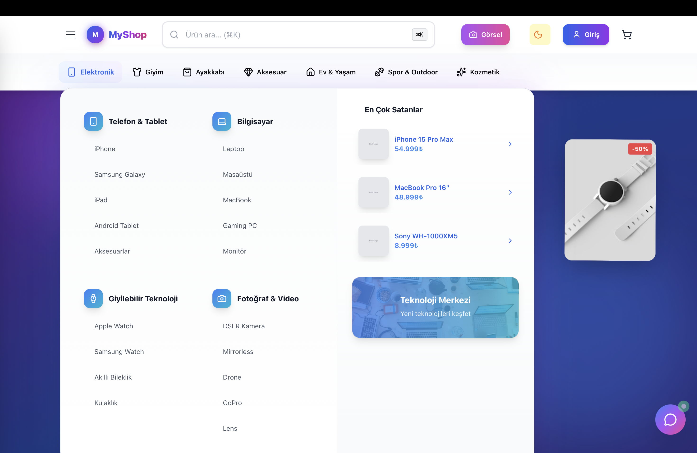
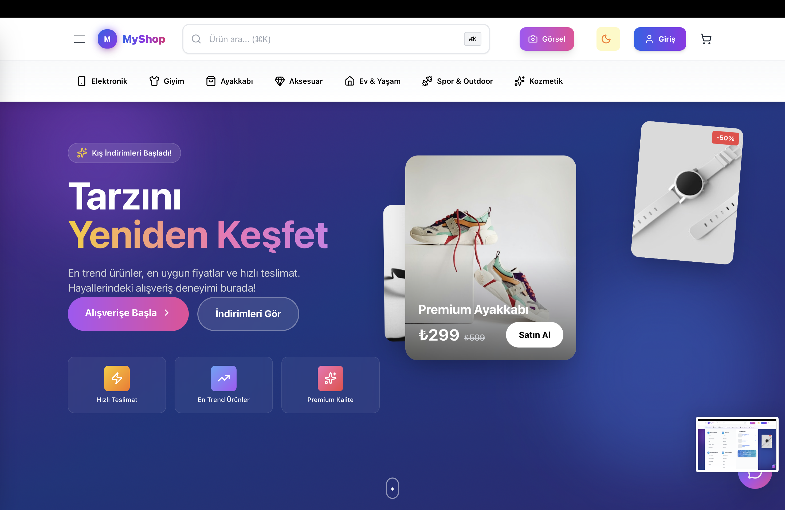
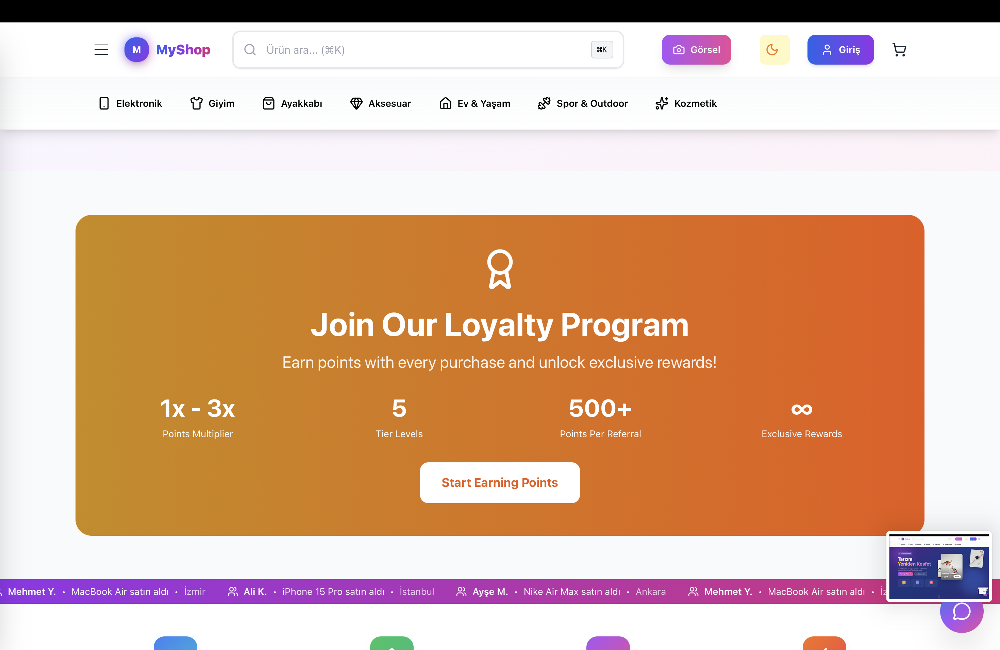
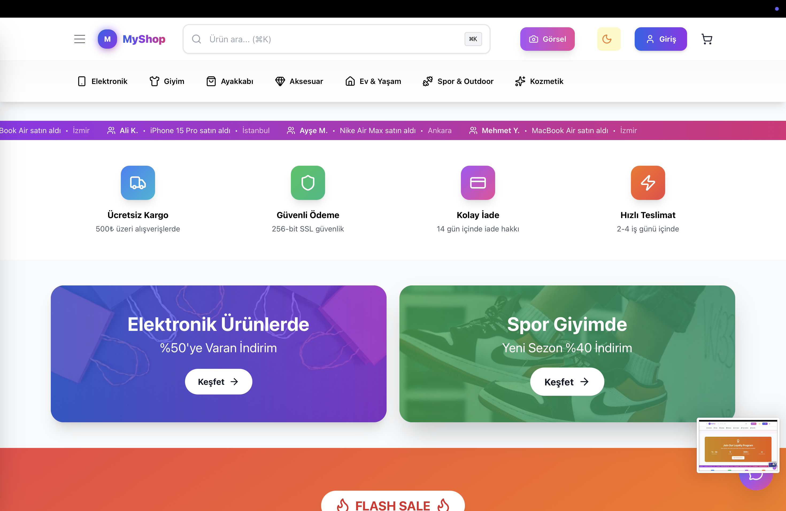
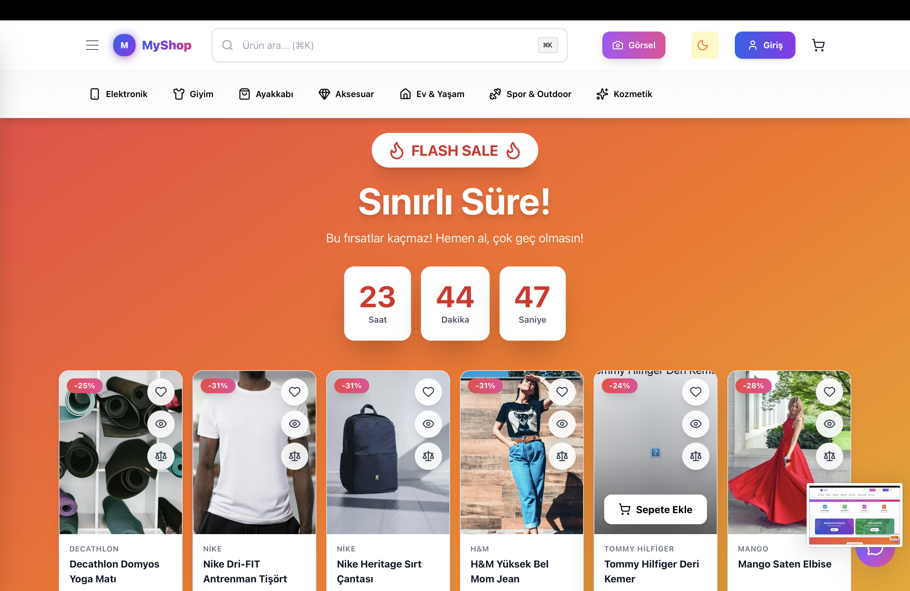
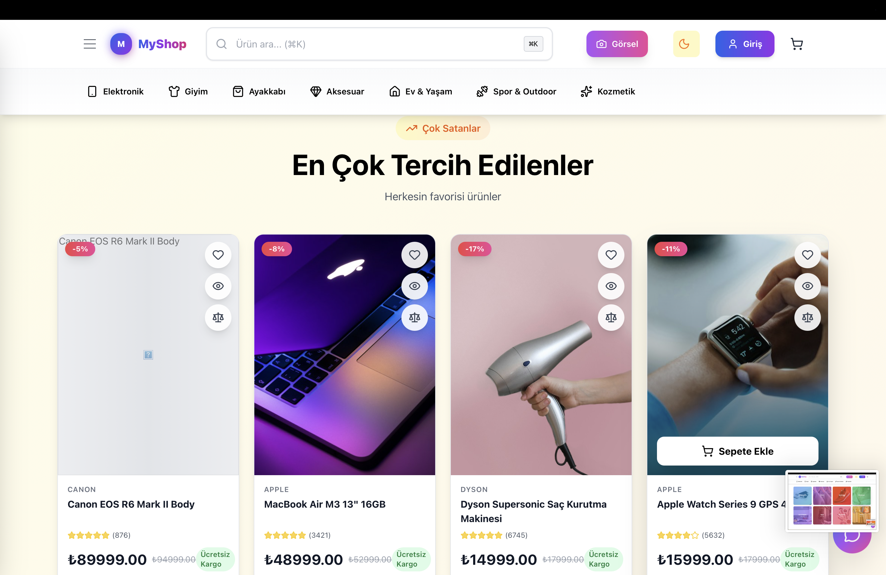
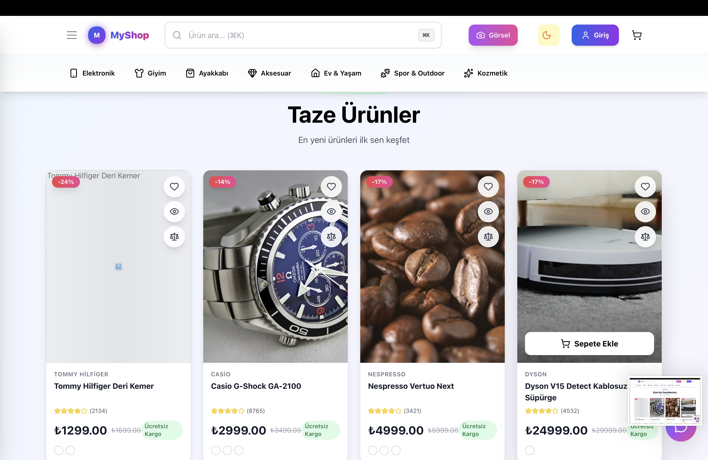
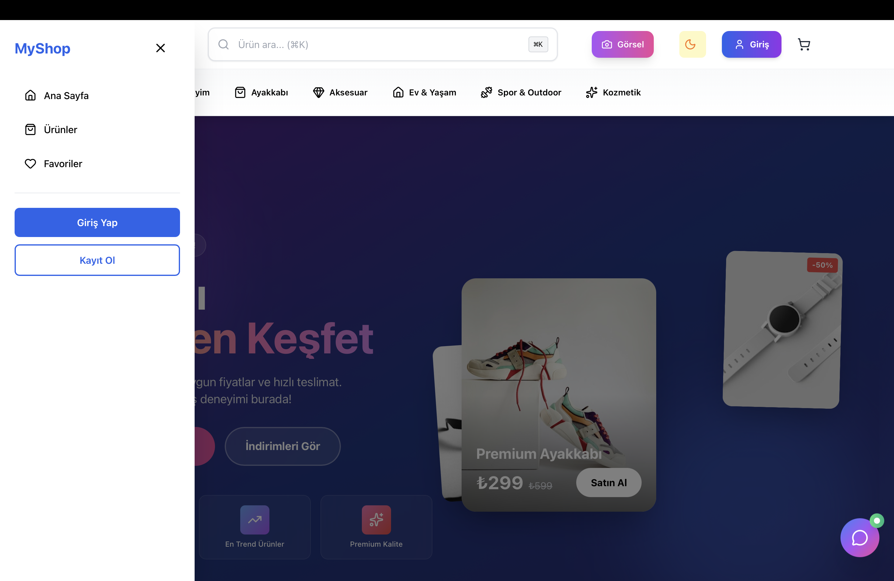

# ShopLane

ShopLane is a full-stack e-commerce platform designed for modern online retail experiences. It combines a scalable Node.js + Express backend with a responsive React + Vite frontend, backed by MongoDB, Redis, and search capabilities through Meilisearch. The project is built to showcase clean architecture, modular API design, product discovery flows, cart and checkout logic, admin dashboards, and secure development practices.

## Overview

This application is structured as a real-world commerce solution with:

- Customer-facing storefront and product browsing
- Product catalog with filtering, sorting, and search
- Cart and order management
- JWT-based authentication and authorization
- Admin analytics and dashboard capabilities
- Redis caching for performance optimization
- API documentation with Swagger
- Dockerized local development environment
- Automated backend testing with Jest and Supertest

## Tech Stack

### Backend
- Node.js
- Express.js
- MongoDB with Mongoose
- Redis for caching and session-related operations
- Meilisearch for catalog search
- JWT for authentication
- Helmet, CORS, rate limiting, and sanitization for security
- Winston + Morgan for structured logging
- Swagger UI + Swagger JSDoc for API docs

### Frontend
- React 19
- Vite
- Tailwind CSS
- Zustand for lightweight state management
- React Router for navigation
- Charting libraries for admin analytics
- Framer Motion and other UI enhancement libraries

### DevOps & Tooling
- Docker
- Docker Compose
- Jest
- Supertest
- GitHub Actions (CI/CD workflows included)

## Project Architecture

The repository is split into two main application areas:

```text
shoplane-ecommerce/
├── backend/              # Express API server and business logic
├── frontend/             # React storefront SPA
├── docs/                 # Project documentation and API references
├── docker-compose.yml    # Local multi-service environment
├── README.md             # Project overview and onboarding
├── SECURITY.md           # Security policy and reporting guidelines
├── CONTRIBUTING.md       # Contribution workflow
├── .github/              # CI workflows and repo automation
└── package.json          # Root scripts and workspace orchestration
```

### Backend responsibilities
- API routing and controllers
- Authentication and authorization
- Product, cart, order, and analytics logic
- Database models and repository patterns
- Security middleware and request validation
- Logging and response standardization

### Frontend responsibilities
- Storefront UX and product discovery
- Shopping cart and checkout experience
- Admin dashboard views
- Integration with backend APIs
- Responsive layout and UI interactions

## Core Features

### Customer Experience
- Product catalog with category filters and search
- Detailed product pages with variants and media
- Shopping cart management
- Checkout flow and order creation
- User account and role-based access

### Admin Capabilities
- Dashboard reports and analytics
- Inventory and store metrics
- Order and user management patterns
- Platform monitoring views

### Performance & Reliability
- Redis caching for high-volume read operations
- Search indexing with Meilisearch
- Centralized API responses for consistent client behavior
- Structured logs for debugging and production visibility

### Security
- Environment-based configuration
- JWT authentication
- Input sanitization and request validation
- Rate limiting and HTTP hardening middleware
- No secrets committed into the repository

## Getting Started

### Prerequisites

Before running the project locally, make sure you have:

- Node.js 20+
- npm or pnpm
- Docker and Docker Compose (recommended)
- MongoDB and Redis if running without containers

### Clone the Repository

```bash
git clone https://github.com/dogukanbayar/shoplane-ecommerce.git
cd shoplane-ecommerce
```

### Environment Configuration

Copy the example environment files:

```bash
cp backend/.env.example backend/.env
cp frontend/.env.example frontend/.env
```

Then update the values as needed for your local setup, especially the database URLs, JWT secrets, and frontend API base URL.

> Security note: all sensitive values should remain in local `.env` files and should never be committed to the repository.

## Running the Project

### Option 1: Docker Compose (Recommended)

This is the easiest way to run the full stack with the required services:

```bash
docker compose up -d --build
```

After the containers are ready:

- Frontend: http://localhost:5173
- Backend API: http://localhost:5001
- Swagger Docs: http://localhost:5001/api/docs

### Option 2: Local Development

#### Start backend

```bash
cd backend
npm install
npm run dev
```

#### Start frontend

```bash
cd frontend
npm install
npm run dev
```

#### Root-level dev runner

If you want to launch both together:

```bash
npm install
npm run dev
```

## Available Scripts

### Root project

```bash
npm run dev
```
Runs frontend and backend concurrently.

### Backend scripts

```bash
cd backend
npm run start
npm run dev
npm run test
npm run test:unit
npm run test:integration
npm run seed
```

### Frontend scripts

```bash
cd frontend
npm run dev
npm run build
npm run preview
npm run test
npm run test:coverage
```

## API Documentation

The backend exposes Swagger documentation at:

```text
http://localhost:5001/api/docs
```

The documentation includes endpoints for:
- Authentication
- Products
- Orders
- Cart
- Loyalty features
- Bundles
- Analytics

For a more static reference, see the project docs in [`docs/API.md`](docs/API.md).

## Testing

The project includes automated backend tests using Jest + Supertest.

Run the full test suite with:

```bash
cd backend
npm test
```

For a specific test file:

```bash
cd backend
npm test -- tests/order.test.js
```

The test suite covers critical e-commerce workflows such as order lifecycle behavior and API verification.

## Screenshots & Showcase

Screenshots of the storefront, customer flows, admin tools, and API documentation:

| View | Screenshot |
| :--- | :--- |
| **Home Page** |  |
| **Product Discovery** |  |
| **Product Detail** |  |
| **Cart** |  |
| **Checkout** |  |
| **Admin Analytics** |  |
| **Order Management** |  |
| **Swagger API Docs** |  |

## Docker Setup

The repository includes a Docker Compose setup with the following services:

- MongoDB
- Redis
- Meilisearch
- Backend service
- Frontend service

This enables local development in a near-production-like environment without requiring manual installation of each dependency on your machine.

## Environment Files

Example configuration files are provided:

- `backend/.env.example`
- `frontend/.env.example`

These should be copied and customized before running the app locally.

## Project Structure Overview

```text
backend/
├── src/
│   ├── config/
│   ├── controllers/
│   ├── jobs/
│   ├── middleware/
│   ├── models/
│   ├── repositories/
│   ├── routes/
│   ├── services/
│   ├── templates/
│   ├── utils/
│   ├── server.js
│   └── ...
├── tests/
├── .env.example
├── Dockerfile
├── package.json
└── ...

frontend/
├── src/
├── public/
├── .env.example
├── Dockerfile
├── vite.config.js
├── tailwind.config.js
├── package.json
└── ...
```

## Security Policy

This project follows secure development best practices:

- Secrets are stored in `.env` files and never committed
- Security headers are enabled with Helmet
- Input sanitization is enabled
- Rate limiting protects public endpoints
- CORS is configured for controlled client access
- JWT-based authentication is used for protected routes

For more details, see [`SECURITY.md`](SECURITY.md).

## Contribution Guidelines

We welcome contributions from the community. For coding standards, branch strategy, and pull request expectations, see [`CONTRIBUTING.md`](CONTRIBUTING.md).

Typical contribution flow:

1. Fork the repository
2. Create a feature branch
3. Implement your changes
4. Run relevant tests
5. Open a pull request with a clear summary

## Git & Branching Strategy

This repository uses a feature-branch workflow to keep `main` stable and make changes easier to review:

- `main`: the stable, production-ready branch.
- `feature/*`: isolated application features, including `feature/swagger-documentation` and `feature/logging-and-standard-response`.
- `feature/order-integration-tests`: automated integration test work.
- `chore/*`: maintenance and repository cleanup, including `chore/clean-artifacts-and-assets`.

Changes are developed on their respective branches and integrated into `main` through pull requests and explicit merge commits with descriptive messages. This keeps feature development, testing, and maintenance work traceable.

## Deployment

This project is prepared for containerized deployment and can be adapted to cloud hosts such as Render, Docker-based environments, or managed app platforms.

The repository includes deployment-related configuration such as:

- `docker-compose.yml`
- `backend/render.yaml`
- GitHub Actions deployment workflow files under `.github/workflows/`

## Roadmap

Possible future enhancements include:

- More advanced payment gateway integrations
- Inventory automation and stock alerts
- Multi-vendor seller support
- Improved recommendation engine
- More robust analytics and reporting
- Internationalization and localization
- PWA enhancements and mobile web optimization

## License

This project is licensed under the ISC license unless otherwise specified in the repository. See the package manifests and project files for current licensing details.

## Contact

For questions, collaboration requests, or contributions, open an issue or contact the repository maintainer.

## Summary

ShopLane is a practical e-commerce application that demonstrates how to build a modern storefront with a secure backend, scalable architecture, testing culture, and real-world operational features. It is a strong starting point for learning full-stack development, e-commerce workflows, and deployment-ready application design.
